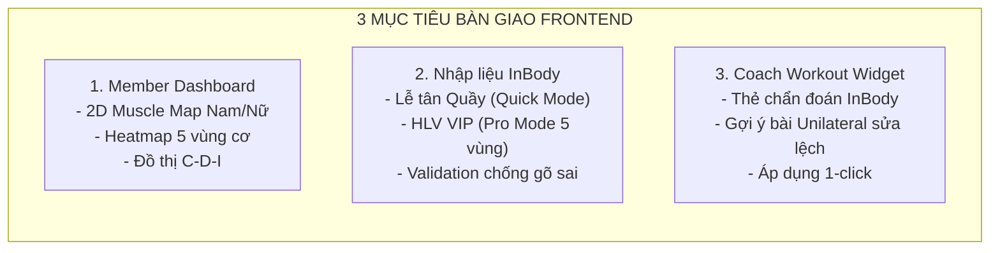

# KẾ HOẠCH TRIỂN KHAI FRONTEND: INBODY TOÀN DIỆN, 2D MUSCLE MAP & TRỢ LÝ GIÁO ÁN

> **Tài liệu bàn giao:** Frontend Implementation Plan & Hand-off Specification  
> **Dành cho:** Frontend Engineering Team  
> **Dự án:** Sports Center Management System (Web Portal)  
> **Thời điểm ban hành:** 18/11/2026  

---

## 1. TỔNG QUAN PHÂN HỆ & CÁC ĐIỂM TÁC ĐỘNG (TOUCHPOINTS)

Tài liệu này hướng dẫn tuần tự các bước triển khai trên repository Frontend (`FE_Sports_Center_Management_System_web`), bao gồm 3 phân hệ chính:
1. **Phân hệ Hội viên (Member Portal - `/portal/member/progress`):** Thay thế 3D Mannequin bằng **2D Interactive Muscle Map (SVG)** phân hóa theo giới tính Nam/Nữ, đồ thị hình thái thể trạng C - D - I và theo dõi tiến trình.
2. **Phân hệ Nhập liệu Quầy & HLV (`/portal/desk/inbody` & `/portal/coach/members`):** Nâng cấp Modal nhập liệu thông minh với 2 chế độ: **Chế độ Nhanh (Quick Mode)** và **Chế độ Chuyên sâu (Pro Mode 5 vùng cơ)**.
3. **Phân hệ Huấn luyện viên (Coach Portal - `/portal/coach/workout-plans`):** Widget **Trợ lý đề xuất giáo án thông minh (Workout DSS)** dựa trên kết quả phân tích InBody của học viên.



---

## 2. PHẦN 1: MEMBER DASHBOARD & 2D INTERACTIVE MUSCLE MAP

### 2.1. Vị trí mã nguồn & Thay thế Component
* **File mục tiêu:** `src/features/member/pages/progress-page.tsx`.
* **Thao tác:** Loại bỏ import `InbodyBodyViewer` (3D Three.js cũ) và thay thế bằng `MuscleMapViewer` (2D SVG mới).
* **Bundle Optimization:** Gỡ bỏ các import Three.js không cần thiết để giảm ~1.2MB bundle size.

### 2.2. Phân hóa Asset theo Giới tính (`users.gender`)
* Truy xuất giới tính từ `useSession().user?.gender` hoặc payload `/users/profile/me`:
  * Nếu `gender === 'MALE'`: Render model **Nam** (khung vai rộng, ngực vạm vỡ, lưng xô chữ V).
  * Nếu `gender === 'FEMALE'`: Render model **Nữ** (eo thon, hông nở, đường cong thể thao).
  * Nếu `gender === 'OTHER'`: Render model thể thao trung tính.

### 2.3. Cấu trúc Component `MuscleMapViewer`
* **File tạo mới:** `src/features/member/components/inbody/muscle-map-viewer.tsx`.
* **2 Chế độ xem:** Mặt trước (`FRONT`) và Mặt sau (`BACK`) với nút Toggle chuyển đổi mượt mà.
* **Ánh xạ nhóm cơ với dữ liệu 5 phân vùng (`segmentalLean`):**
  * `rightArm` $\leftrightarrow$ Bắp tay trước/sau phải, vai phải, cẳng tay phải.
  * `leftArm` $\leftrightarrow$ Bắp tay trước/sau trái, vai trái, cẳng tay trái.
  * `trunk` $\leftrightarrow$ Ngực, bụng, liên sườn, lưng xô, lưng dưới.
  * `rightLeg` $\leftrightarrow$ Đùi trước phải, đùi sau phải, bắp chân phải, mông phải.
  * `leftLeg` $\leftrightarrow$ Đùi trước trái, đùi sau trái, bắp chân trái, mông trái.
* **Quy chuẩn mã màu Heatmap CSS:**
  * `#10b981` (Xanh ngọc): Cơ bắp phát triển lý tưởng ($\ge 100\%$ so với chuẩn).
  * `#60a5fa` (Xanh dương): Phát triển ở mức bình thường ($90\% - 99\%$).
  * `#f59e0b` (Vàng cam): Cơ dưới chuẩn ($80\% - 89\%$).
  * `#ef4444` (Đỏ cảnh báo): Lệch cơ nghiêm trọng ($> 8\%$ so với bên đối diện) hoặc teo cơ ($< 80\%$).
* **Tooltip tương tác:** Hover hoặc click vào từng vùng cơ để hiện Popover chi tiết (khối lượng kg và tỷ lệ % phát triển).

### 2.4. Đồ thị Hình thái Thể trạng C - D - I
* **Component:** `src/features/member/components/inbody/inbody-shape-card.tsx`.
* Vẽ đồ thị thanh ngang liên kết 3 chỉ số: **Cân nặng - Cơ xương (SMM) - Khối lượng mỡ (BFM)**.
* Tự động hiển thị huy hiệu thể trạng:
  * **Dáng chữ C:** Cần giảm mỡ, kích hoạt tăng cơ.
  * **Dáng chữ I:** Thể trạng cân đối chuẩn.
  * **Dáng chữ D:** Thể hình thể thao săn chắc.

---

## 3. PHẦN 2: MODAL NHẬP LIỆU QUẦY LỄ TÂN & HUẤN LUYỆN VIÊN

### 3.1. Vị trí mã nguồn
* Lễ tân: `src/features/front-desk/components/inbody-modal.tsx`.
* Huấn luyện viên: `src/features/coach-portal/components/inbody-log-modal.tsx`.

### 3.2. Thiết kế 2 Chế độ Nhập liệu (Tabs / Segmented Control)

#### Chế độ 1: Nhập Nhanh (Quick Mode - Dành cho Lễ tân lúc đông khách, dưới 30 giây)
* **Chỉ nhập 4 trường bắt buộc:**
  1. Chiều cao (`heightCm`)
  2. Cân nặng (`weightKg`)
  3. Khối lượng cơ xương (`skeletalMuscleMassKg` / SMM)
  4. Tỷ lệ % mỡ (`bodyFatPct` / PBF)
* **Frontend Real-time Calculation:**
  Ngay khi nhập xong, form tự tính và hiển thị preview mờ:
  * $\text{BFM (kg)} = \text{weightKg} \times (\text{bodyFatPct} / 100)$
  * $\text{LBM (kg)} = \text{weightKg} - \text{BFM}$
  * $\text{BMI} = \text{weightKg} / (\text{heightCm} / 100)^2$
  * $\text{BMR} = 370 + (21.6 \times \text{LBM})$

#### Chế độ 2: Nhập Chuyên Sâu (Pro Mode - Dành cho HLV & Khách VIP)
* Cho phép nhập thêm:
  * Nước (`tbwLiters`), Protein (`proteinKg`), Khoáng (`mineralKg`).
  * Mỡ nội tạng (`visceralFatLevel`: 1–20), Tỷ lệ eo/hông (`waistHipRatio`), Điểm InBody (`inbodyScore`).
  * **5 vùng cơ (`segmentalLean`):** Tay Phải, Tay Trái, Thân, Chân Phải, Chân Trái.

### 3.3. Bộ quy tắc kiểm tra hợp lệ dữ liệu (Client-side Validation)
* Báo đỏ và khóa nút Lưu nếu:
  * $\text{SMM} + \text{BFM} \ge \text{weightKg}$ (Cơ + Mỡ vượt quá tổng cân nặng).
  * Chiều cao $< 50\text{cm}$ hoặc $> 250\text{cm}$.
  * Cân nặng $< 20\text{kg}$ hoặc $> 300\text{kg}$.
  * % Mỡ $< 3\%$ hoặc $> 65\%$.

---

## 4. PHẦN 3: WIDGET ĐỀ XUẤT GIÁO ÁN VÀO COACH PORTAL (WORKOUT DSS)

### 4.1. Vị trí mã nguồn
* Màn hình tạo giáo án: `src/features/coach-portal/pages/coach-workout-plans-page.tsx`.
* Hoặc Modal lập giáo án chi tiết học viên trong `src/features/coach-portal/pages/coach-members-page.tsx`.

### 4.2. Giao diện Thẻ Chẩn đoán Thể trạng (InBody Diagnostic Card)
Khi HLV mở form tạo Workout Plan cho một học viên:
1. Tự động gọi API `GET /api/v1/workout-plans/recommendations/:memberId`.
2. Hiển thị Card tóm tắt:
   ```
   +---------------------------------------------------------------------------------------+
   | CHẨN ĐOÁN THỂ TRẠNG INBODY (Đo ngày 15/11/2026)                                       |
   | • Dáng người: Chữ C (Cơ: 24.5kg - Mỡ: 28.2%) -> Đề xuất: Đốt mỡ & Tái cấu trúc cơ   |
   | • ⚠️ CẢNH BÁO LỆCH CƠ: Tay trái yếu hơn tay phải -11.8%                               |
   | • Mỡ nội tạng: Cấp độ 11 (Cần Cardio nhịp tim Zone 2)                                |
   +---------------------------------------------------------------------------------------+
   | [✨ Áp dụng giáo án đề xuất 1-Click]             [Tự soạn bài tập thủ công]           |
   +---------------------------------------------------------------------------------------+
   ```

### 4.3. Xử lý hành động 1-Click "Áp dụng giáo án đề xuất"
Khi HLV bấm nút:
* Danh sách bài tập của form tự động được điền các bài tập khắc phục:
  * Nếu lệch tay: Tự động chèn bài tập Unilateral: *Single-Arm Dumbbell Bench Press*, *Dumbbell Alternating Bicep Curls*.
  * Nếu lệch chân: Tự động chèn: *Bulgarian Split Squats*, *Single-Leg Romanian Deadlift*.
  * Nếu mỡ nội tạng cao: Tự động bổ sung bài Cardio cuối buổi: *Incline Treadmill Walk (Zone 2)*.
* Tự động điền số Sets, Reps và Ghi chú chuẩn: *"Bắt đầu với tay trái trước, lấy số rep bên trái làm chuẩn cho bên phải"*.
* HLV vẫn có toàn quyền tăng giảm số rep/mức tạ trước khi bấm "Lưu giáo án".

---

## 5. API CONTRACTS & DTO PHÍA BACKEND

Frontend gọi các endpoint tương ứng:

### 1. Tạo/Cập nhật phiếu đo InBody
* **Method:** `POST /api/v1/inbody/logs` hoặc `PUT /api/v1/inbody/logs/:id`
* **Request Body Payload:**
```json
{
  "userId": "uuid",
  "heightCm": 175.5,
  "weightKg": 72.0,
  "bodyFatPct": 18.5,
  "skeletalMuscleMassKg": 34.2,
  "tbwLiters": 42.5,
  "proteinKg": 11.2,
  "mineralKg": 3.8,
  "visceralFatLevel": 6,
  "waistHipRatio": 0.82,
  "inbodyScore": 82,
  "segmentalLean": {
    "rightArm": 3.4,
    "leftArm": 3.1,
    "trunk": 26.5,
    "rightLeg": 8.8,
    "leftLeg": 8.7
  },
  "notes": "Đo đầu tháng sau 4 tuần tập PT"
}
```

### 2. Lấy dữ liệu biểu đồ hội viên
* **Method:** `GET /api/v1/inbody/my-progress` (Member) hoặc `GET /api/v1/inbody/progress/:memberId` (Coach/Staff)
* **Response Payload:** Danh sách mảng phiếu đo có đầy đủ các trường suy diễn: `bmi`, `bodyFatMassKg`, `leanBodyMassKg`, `bmrKcal`, `imbalanceAnalysis` (tỷ lệ lệch cơ tay/chân và dáng C-D-I).

### 3. Lấy khuyến nghị giáo án tập luyện theo InBody
* **Method:** `GET /api/v1/workout-plans/recommendations/:memberId`
* **Response Payload:**
```json
{
  "memberId": "uuid",
  "lastMeasuredAt": "2026-11-15T08:30:00Z",
  "bodyShape": "TYPE_C",
  "primaryGoal": "FAT_LOSS_RECOMP",
  "hasMuscleImbalance": true,
  "imbalances": [
    {
      "zone": "ARMS",
      "weakerSide": "LEFT",
      "imbalancePct": 11.8,
      "severity": "SIGNIFICANT"
    }
  ],
  "suggestedTemplateId": "template-uuid-hypertrophy-rebalance",
  "recommendedExercises": [
    {
      "exerciseId": "ex-uuid-1",
      "exerciseName": "Single-Arm Dumbbell Bench Press",
      "category": "CHEST",
      "sets": 4,
      "reps": 10,
      "unilateral": true,
      "targetSide": "LEFT_PRIORITY"
    }
  ],
  "cardioRecommendation": {
    "targetHeartRateZone": "ZONE_2",
    "durationMinutes": 25,
    "reason": "Mỡ nội tạng mức 11 cần kích hoạt huy động mỡ bằng cardio nhẹ"
  }
}
```

---

## 6. TUẦN TỰ BÀN GIAO & TIÊU CHÍ HOÀN THÀNH (DOD)

1. **Step 1:** Tạo Component SVG `MuscleMapViewer` với 2 asset nam/nữ (`male-muscle-map.tsx`, `female-muscle-map.tsx`).
2. **Step 2:** Nâng cấp `progress-page.tsx`, liên kết Heatmap màu sắc và Tooltip 5 phân vùng.
3. **Step 3:** Nâng cấp `inbody-modal.tsx` (Lễ tân) và `inbody-log-modal.tsx` (HLV) hỗ trợ Chế độ Nhanh & Chế độ Pro.
4. **Step 4:** Tích hợp InBody Recommendation Widget vào phân hệ tạo Workout Plan của HLV.
5. **Step 5:** Kiểm thử biên dịch `npm run build` trên `FE_Sports_Center_Management_System_web` đạt 0 lỗi.
