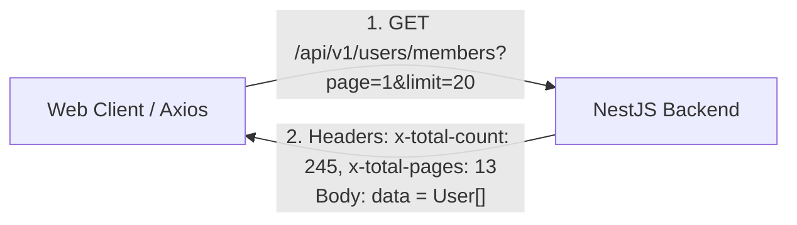

# HƯỚNG DẪN TÍCH HỢP FRONTEND: QUY CHUẨN THỜI GIAN & PHÂN TRANG HTTP HEADERS

Tài liệu này đặc tả quy chuẩn giao tiếp mới giữa Frontend và Backend sau đợt chuẩn hóa:
1. **Chuẩn hóa Timezone Lịch 7 ngày (Vietnam Timezone $\leftrightarrow$ UTC)**.
2. **Cơ chế Phân trang qua HTTP Response Headers (Zero Breaking Changes)**.

---

## 1. TỔNG QUAN NGUYÊN TẮC THIẾT KẾ (DESIGN PRINCIPLES)

> [!IMPORTANT]
> **Cam kết 100% Zero Breaking Changes cho Frontend**:
> - Cấu trúc Response Body của toàn bộ các phương thức `GET` **vẫn là mảng `T[]` nguyên bản** (hoặc `{ success: true, data: T[] }` qua interceptor).
> - Frontend hiện tại chưa truyền query params phân trang vẫn nhận dữ liệu bình thường, các hàm `.map()`, `.filter()` **hoàn toàn không bị crash**.
> - Metadata phân trang được đóng gói trong **HTTP Response Headers**, đã được cấu hình CORS `exposedHeaders` tại Backend để trình duyệt truy xuất trực tiếp.



---

## 2. NHÓM 1: CÁC ENDPOINT LỊCH 7 NGÀY (7-DAY CALENDAR & SCHEDULE)

Toàn bộ các UI dạng Grid tuần (7 ngày từ Thứ Hai đến Chủ Nhật) hiện đã hỗ trợ nhận query param `from` và `to`. Backend sẽ tự động quy đổi ngày làm việc Việt Nam (`Asia/Ho_Chi_Minh`) sang đúng dải UTC trong cơ sở dữ liệu.

### Danh sách Endpoints:

| Endpoint | Method | Query Parameters mới | Mô tả & Cách dùng |
| :--- | :--- | :--- | :--- |
| `/api/v1/schedules` | `GET` | `from?: string`<br/>`to?: string`<br/>`coachId?: string`<br/>`disciplineId?: string` | Lấy danh sách lịch lớp học. Truyền `from=2026-11-16&to=2026-11-22` để lấy đúng 7 ngày trong tuần của Quản lý / Lễ tân / HLV. |
| `/api/v1/staff-shifts` | `GET` | `from?: string`<br/>`to?: string`<br/>`staffId?: string` | Lấy danh sách ca trực nhân sự (Manager xem lịch tuần). |
| `/api/v1/staff-shifts/mine` | `GET` | `from?: string`<br/>`to?: string` | Lấy ca trực của chính lễ tân/HLV đang đăng nhập trong tuần. |
| `/api/v1/coaches/availability` | `GET` | `from?: string`<br/>`to?: string`<br/>`coachId?: string` | Lấy các slot rảnh 1-1 của HLV để hội viên đặt chỗ trong tuần. |
| `/api/v1/coaches/availability/mine`| `GET` | `from?: string`<br/>`to?: string` | HLV quản lý danh sách slot rảnh của chính mình theo tuần. |
| `/api/v1/coaches/today-schedule` | `GET` | `date?: string` *(YYYY-MM-DD)* | Mặc định lấy lịch hôm nay. Cho phép truyền `?date=2026-11-19` để xem ngày khác trên Agenda. |
| `/api/v1/members/me/calendar` | `GET` | `week: string`<br/>`disciplineId?: string`<br/>`view?: string` | Lịch cá nhân của hội viên (đã chuẩn sẵn). |

### ⚠️ Lưu ý sửa lỗi Frontend khi tạo và hiển thị Ca trực (Staff Shifts):

1. **Tại modal Xếp ca hàng loạt (`features/manager/components/bulk-shift-modal.tsx`)**:
   - **Lỗi cũ**: Nối cứng chuỗi đuôi `Z` (`${dayStr}T${startTime}:00Z`), làm lệch 7 tiếng trong DB.
   - **Cách sửa**: Sử dụng hàm `vnInstant(dayStr, startTime)` đã có sẵn trong `features/manager/lib/format.ts`:
     ```typescript
     // SỬA THÀNH:
     startTime: vnInstant(dayStr, startTime),
     endTime: vnInstant(dayStr, endTime),
     ```
2. **Tại modal Xem lịch trực (`features/front-desk/components/my-shifts-modal.tsx`)**:
   - **Lỗi cũ**: Lọc ngày theo UTC `new Date(s.startTime).toISOString().slice(0, 10)`, làm trôi ca sáng sang ngày hôm trước.
   - **Cách sửa**: Lọc theo trường `shiftDate` có sẵn hoặc dùng hàm định dạng ngày Việt Nam:
     ```typescript
     // SỬA THÀNH:
     const dayShifts = shifts.filter((s) => s.shiftDate.slice(0, 10) === col.dateStr);
     ```

---

## 3. NHÓM 2: PHÂN TRANG QUA HTTP RESPONSE HEADERS (PAGINATION)

### Cơ chế Response Headers

Khi gọi các endpoint danh sách lớn, Backend sẽ tự động đính kèm 4 headers sau vào HTTP Response:

| Header Name | Kiểu | Ý nghĩa | Ví dụ |
| :--- | :--- | :--- | :--- |
| `x-total-count` | `number` | Tổng số bản ghi thỏa mãn điều kiện lọc trong toàn DB | `245` |
| `x-page` | `number` | Trang hiện tại (bắt đầu từ 1) | `1` |
| `x-limit` | `number` | Số lượng bản ghi trên một trang | `20` |
| `x-total-pages` | `number` | Tổng số trang (`ceil(total / limit)`) | `13` |

### Danh sách 12 Endpoints hỗ trợ phân trang Headers:

1. `GET /api/v1/users/members`:
   - Query: `page?: number`, `limit?: number` (default 50), `q?: string` (tên, sđt, email).
2. `GET /api/v1/users`:
   - Query: `page?: number`, `limit?: number`, `role?: UserRole`, `q?: string`.
3. `GET /api/v1/bookings`:
   - Query: `page?: number`, `limit?: number`, `status?: BookingStatus`, `memberId?: string`, `from?: string`, `to?: string`.
4. `GET /api/v1/billing/invoices`:
   - Query: `page?: number`, `limit?: number`, `memberId?: string`, `from?: string`, `to?: string`.
5. `GET /api/v1/billing/checkouts`:
   - Query: `page?: number`, `limit?: number`, `memberId?: string`, `status?: CheckoutStatus`.
6. `GET /api/v1/attendances`:
   - Query: `page?: number`, `limit?: number`, `memberId?: string`, `from?: string`, `to?: string`.
7. `GET /api/v1/audit-logs`:
   - Query: `page?: number`, `limit?: number`, `action?: string`, `targetEntity?: string`, `from?: string`, `to?: string`.
8. `GET /api/v1/cancellation-requests`:
   - Query: `page?: number`, `limit?: number`, `status?: CancellationRequestStatus`, `page?: number`, `limit?: number`.
9. `GET /api/v1/coach-penalties`:
   - Query: `page?: number`, `limit?: number`.
10. `GET /api/v1/workout-plans`:
    - Query: `page?: number`, `limit?: number`, `memberId?: string`, `coachId?: string`.
11. `GET /api/v1/exercise-knowledge`:
    - Query: `page?: number`, `limit?: number`, `q?: string`, `category?: string`.
12. `GET /api/v1/lockers`:
    - Query: `zone?: string`, `status?: LockerStatus`.

---

## 4. CODE SNIPPET MẪU DÀNH CHO FRONTEND

### Cách 1: Bóc tách Pagination Headers qua Axios thông thường

```typescript
import apiClient from '@/services/api-client';

export interface PaginatedResponse<T> {
  data: T[];
  pagination: {
    total: number;
    page: number;
    limit: number;
    totalPages: number;
  };
}

export async function fetchMembers(page = 1, limit = 20, q = ''): Promise<PaginatedResponse<UserItem>> {
  const res = await apiClient.get('/users/members', {
    params: { page, limit, q },
  });

  return {
    data: res.data.data, // Mảng T[] nguyên bản
    pagination: {
      total: Number(res.headers['x-total-count'] || 0),
      page: Number(res.headers['x-page'] || page),
      limit: Number(res.headers['x-limit'] || limit),
      totalPages: Number(res.headers['x-total-pages'] || 1),
    },
  };
}
```

### Cách 2: Sử dụng với React Query

```typescript
import { useQuery } from '@tanstack/react-query';
import { useState } from 'react';
import { fetchMembers } from './member-api';

export function MemberTable() {
  const [page, setPage] = useState(1);
  const [search, setSearch] = useState('');

  const { data, isLoading } = useQuery({
    queryKey: ['members', page, search],
    queryFn: () => fetchMembers(page, 20, search),
    keepPreviousData: true,
  });

  return (
    <div>
      {/* Bảng dữ liệu: data.data.map(...) */}
      <table>
        <tbody>
          {data?.data.map((user) => (
            <tr key={user.id}><td>{user.fullName}</td></tr>
          ))}
        </tbody>
      </table>

      {/* Điều khiển phân trang */}
      <div className="pagination-bar">
        <span>Trang {data?.pagination.page} / {data?.pagination.totalPages} (Tổng: {data?.pagination.total} hội viên)</span>
        <button disabled={page <= 1} onClick={() => setPage((p) => p - 1)}>Trước</button>
        <button disabled={page >= (data?.pagination.totalPages || 1)} onClick={() => setPage((p) => p + 1)}>Sau</button>
      </div>
    </div>
  );
}
```

---

## 5. TỔNG KẾT

- Backend đã được kiểm thử đồng bộ với lệnh `npm run test:openapi` (**PASS 135/135 endpoints**).
- Không có bất kỳ endpoint nào bị đổi đường dẫn hay thay đổi cấu trúc Body trả về.
- Đội ngũ Frontend có thể triển khai cập nhật giao diện phân trang theo từng màn hình một cách độc lập và an toàn tuyệt đối.
