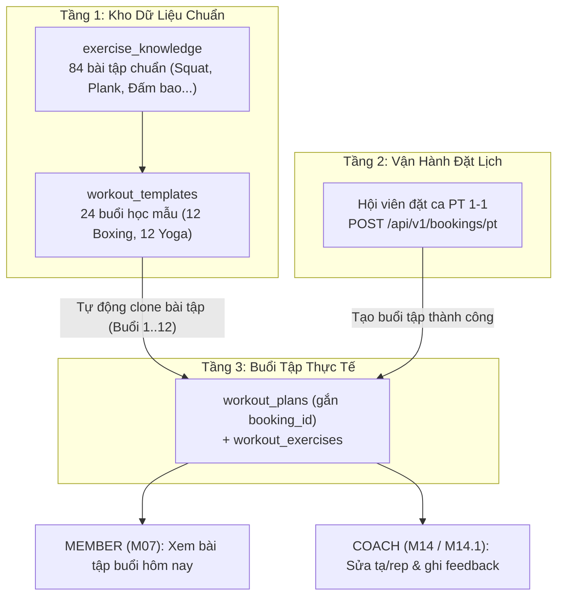

# TÀI LIỆU HƯỚNG DẪN TÍCH HỢP FRONTEND / MOBILE
## PHÂN HỆ: GIÁO ÁN TẬP LUYỆN, LỘ TRÌNH 12 BUỔI MẪU & TỰ ĐỘNG GẮN BÀI TẬP VÀO LỊCH PT

> **Dành cho:** Đội ngũ phát triển Frontend (Web Portal) & Mobile App (Flutter / React Native)  
> **Cập nhật ngày:** 30/10/2026  
> **Backend Base URL:** `http://localhost:3000/api/v1` (hoặc biến môi trường `API_URL`)  
> **Tiêu chuẩn Envelope:** Tất cả phản hồi thành công bọc trong:
> ```json
> {
>   "success": true,
>   "statusCode": 200,
>   "data": ...,
>   "timestamp": "2026-10-30T19:30:00.000Z"
> }
> ```

---

## 1. TỔNG QUAN KIẾN TRÚC & LUỒNG DỮ LIỆU MỚI

Hệ thống quản lý giáo án tập luyện gồm 3 tầng dữ liệu liên kết chặt chẽ:



---

## 2. BẢN ĐỒ MÀN HÌNH TÍCH HỢP (SCREEN MAPPING)

| Mã MH | Tên Màn Hình | Vai trò | Chức năng tích hợp mới | API tương ứng |
| :--- | :--- | :---: | :--- | :--- |
| **M06** | **Đặt Huấn Luyện Viên 1-1** | `MEMBER` | Hội viên chọn slot HLV $\rightarrow$ Đặt chỗ. **Hệ thống tự động gắn luôn giáo án 12 buổi vào buổi tập này.** | `POST /api/v1/bookings/pt` |
| **M07** | **Lịch Tập Của Tôi & Chi Tiết Buổi** | `MEMBER` | Bấm vào một buổi tập PT sắp tới $\rightarrow$ Hiển thị danh sách động tác, số hiệp, thời gian nghỉ và lời dặn của HLV. | `GET /api/v1/bookings/:bookingId/workout-plan` |
| **M09** | **Trợ Lý AI & Tra Cứu Bài Tập** | `MEMBER` | Tra cứu kỹ thuật động tác từ kho 84 bài tập chuẩn. | `GET /api/v1/exercise-knowledge` |
| **M14** | **Lộ Trình Khung 12 Buổi Mẫu** | `COACH` / `MEMBER` | Xem đề cương 12 buổi mẫu của Boxing/Yoga (để tư vấn học viên hoặc nắm giáo trình). | `GET /api/v1/workout-templates?discipline=BOXING` |
| **M14.1**| **Chỉnh Sửa Giáo Án Buổi Tập** | `COACH` | Trong buổi dạy, HLV điều chỉnh mức tạ, số hiệp, đổi bài tập và ghi nhận xét `coach_feedback`. | `PUT /api/v1/workout-plans/:id` |

---

## 3. CHI TIẾT CÁC API VÀ PAYLOAD TÍCH HỢP

### API 1: Xem Lộ Trình 12 Buổi Mẫu (Workout Templates Catalog)
Dùng để hiển thị danh sách 12 buổi mẫu của môn Boxing hoặc Yoga cho Hội viên / HLV xem trước giáo trình.

* **Method:** `GET`
* **URL:** `/api/v1/workout-templates?discipline=BOXING` *(hoặc `?discipline=YOGA`, hoặc bỏ query để lấy tất cả)*
* **Headers:** `Authorization: Bearer <accessToken>`
* **Response Mẫu (`data`):**
```json
{
  "success": true,
  "statusCode": 200,
  "data": [
    {
      "id": "a1b2c3d4-e5f6-4a7b-8c9d-0e1f2a3b4c5d",
      "templateCode": "WORKOUT_PLAN_BOXING_01",
      "disciplineCode": "BOXING",
      "title": "Nền tảng: Tư thế & Jab-Cross",
      "weekNumber": 1,
      "sessionOrder": 1,
      "description": "Boxing 4 tuần: nền tảng → combo & phòng thủ...",
      "exercises": [
        {
          "id": "e1-uuid",
          "exerciseId": "99351052-1981-447a-af39-a9a3b90875e5",
          "sets": 3,
          "reps": 120,
          "unit": "seconds",
          "weightKg": null,
          "restSeconds": 30,
          "orderIndex": 1,
          "exercise": {
            "title": "Nhảy dây (Jump Rope)",
            "category": "cardio",
            "instructions": "[Code: EXERCISE_JUMP_ROPE] [Môn: BOXING] [Nhóm cơ: full_body]..."
          }
        },
        {
          "id": "e2-uuid",
          "exerciseId": "69733c7f-f3e1-43e8-ab68-1ebba75c5ba7",
          "sets": 4,
          "reps": 20,
          "unit": "reps",
          "weightKg": null,
          "restSeconds": 45,
          "orderIndex": 2,
          "exercise": {
            "title": "Jab – Cross (Jab-Cross Drill)",
            "category": "technique"
          }
        }
      ]
    }
  ]
}
```

---

### API 2: Đặt Lịch PT 1-1 (Tự Động Kích Hoạt Gán Bài Tập)
Hội viên đặt lịch tập với Huấn luyện viên. **FE không cần gọi thêm bất kỳ API nào khác**, Backend sẽ tự động đếm buổi tập (1 đến 12) và sinh giáo án tương ứng.

* **Method:** `POST`
* **URL:** `/api/v1/bookings/pt`
* **Headers:** 
  ```http
  Authorization: Bearer <memberAccessToken>
  Content-Type: application/json
  ```
* **Request Body:**
  ```json
  {
    "coachAvailabilityId": "c6a1b2c3-d4e5-4f6a-8b9c-0d1e2f3a4b5c",
    "disciplineId": "d8e9f0a1-b2c3-4d5e-6f7a-8b9c0d1e2f3a",
    "equipmentId": "optional-uuid-giu-may-tap"
  }
  ```
* **Response Mẫu (201 Created):**
  ```json
  {
    "success": true,
    "statusCode": 201,
    "data": {
      "id": "booking-uuid-7788",
      "bookingId": "booking-uuid-7788",
      "bookingType": "PERSONAL_TRAINING",
      "status": "CONFIRMED",
      "remainingPtSessions": 11
    }
  }
  ```
  *(Ngay thời điểm này, bài tập của buổi 1 đã được gắn hoàn tất vào `booking-uuid-7788` trong database)*.

---

### API 3: Xem Bài Tập Của Buổi Tập Cụ Thể (M07 & M14)
Khi Hội viên hoặc Huấn luyện viên bấm vào một buổi tập trong danh sách lịch:

* **Method:** `GET`
* **URL:** `/api/v1/bookings/:bookingId/workout-plan`
* **Headers:** `Authorization: Bearer <accessToken>`
* **Response Mẫu (200 OK):**
```json
{
  "success": true,
  "statusCode": 200,
  "data": {
    "id": "plan-instance-uuid",
    "bookingId": "booking-uuid-7788",
    "sessionOrder": 1,
    "title": "Nền tảng: Tư thế & Jab-Cross",
    "notes": "Boxing 4 tuần: nền tảng...",
    "exercises": [
      {
        "id": "we-uuid-01",
        "exerciseId": "99351052-1981-447a-af39-a9a3b90875e5",
        "sets": 3,
        "reps": 120,
        "weightKg": null,
        "restSeconds": 30,
        "coachFeedback": null,
        "orderIndex": 0,
        "exercise": {
          "title": "Nhảy dây (Jump Rope)",
          "category": "cardio",
          "instructions": "[Code: EXERCISE_JUMP_ROPE] [Môn: BOXING] [Thiết bị: jump_rope] [Đơn vị: seconds]"
        }
      },
      {
        "id": "we-uuid-02",
        "exerciseId": "69733c7f-f3e1-43e8-ab68-1ebba75c5ba7",
        "sets": 4,
        "reps": 20,
        "weightKg": null,
        "restSeconds": 45,
        "coachFeedback": null,
        "orderIndex": 1,
        "exercise": {
          "title": "Jab – Cross (Jab-Cross Drill)",
          "category": "technique"
        }
      }
    ]
  }
}
```
* **Lưu ý UI:** Nếu buổi tập đó là buổi phát sinh thêm (buổi thứ 13 trở đi), trường `data` có thể là `null` (chờ HLV tự lên bài). FE nên hiển thị empty state: *"Buổi tập tự do/cardio nhẹ. HLV sẽ trực tiếp hướng dẫn tại phòng tập"*.

---

### API 4: HLV Tùy Chỉnh Giáo Án Buổi Tập (M14.1)
Khi học viên tập thực tế, HLV có thể tăng giảm số hiệp, nhập mức tạ thực tế (`weightKg`) và để lại nhận xét (`coachFeedback`).

* **Method:** `PUT`
* **URL:** `/api/v1/workout-plans/:id` *(với `:id` là `data.id` lấy từ API 3)*
* **Headers:** 
  ```http
  Authorization: Bearer <coachAccessToken>
  Content-Type: application/json
  ```
* **Request Body:**
  ```json
  {
    "notes": "Hôm nay em tập rất tốt, chú ý hạ thấp trọng tâm khi né đòn",
    "exercises": [
      {
        "exerciseId": "99351052-1981-447a-af39-a9a3b90875e5",
        "sets": 3,
        "reps": 120,
        "weightKg": null,
        "restSeconds": 30,
        "coachFeedback": "Khởi động nhảy dây liên tục không vấp"
      },
      {
        "exerciseId": "69733c7f-f3e1-43e8-ab68-1ebba75c5ba7",
        "sets": 4,
        "reps": 25,
        "weightKg": null,
        "restSeconds": 45,
        "coachFeedback": "Đòn Cross đã có lực xoay hông chuẩn"
      }
    ]
  }
  ```
* **Response:** Trả về bản ghi `workout_plan` đã cập nhật.

---

### API 5: Tra Cứu Thư Viện 84 Bài Tập (M09 / Exercise Knowledge)
* **Method:** `GET`
* **URL:** `/api/v1/exercise-knowledge`
* **Headers:** `Authorization: Bearer <accessToken>`
* **Mục đích:** Tìm kiếm bài tập, hiển thị hướng dẫn chi tiết về nhóm cơ, dụng cụ tập luyện.

---

## 4. HƯỚNG DẪN XỬ LÝ UX & STATE MANAGEMENT CHO FE DEV

1. **Sau khi Đặt lịch PT (`POST /api/v1/bookings/pt`) thành công:**
   * Invalidate hoặc refetch lại lịch tuần: `GET /api/v1/members/me/calendar`.
   * Cập nhật số buổi còn lại `remainingPtSessions` trên Header/Card tóm tắt.
   * Cho phép học viên bấm vào buổi tập vừa tạo $\rightarrow$ mở Modal/Drawer gọi `GET /api/v1/bookings/:id/workout-plan` để thấy ngay bài tập buổi 1.
2. **Quy tắc đếm tuần tự (Session 1 $\to$ 12):**
   * Nếu học viên hủy lịch đúng hạn ($\ge 2$ tiếng) và đặt lại: Hệ thống sẽ tự động bù lại đúng số thứ tự buổi học chưa tập, FE không cần tính toán thủ công.
3. **Màn hình HLV (Coach Mobile):**
   * Trong danh sách ca dạy hôm nay (`GET /api/v1/coaches/today-schedule`), mỗi ca PT kèm `bookingId`.
   * HLV chỉ cần bấm vào ca dạy $\rightarrow$ App gọi `GET /api/v1/bookings/:id/workout-plan` để load sẵn danh sách động tác. HLV chỉ cần tích chọn số hiệp hoàn thành và nhập nhận xét.
