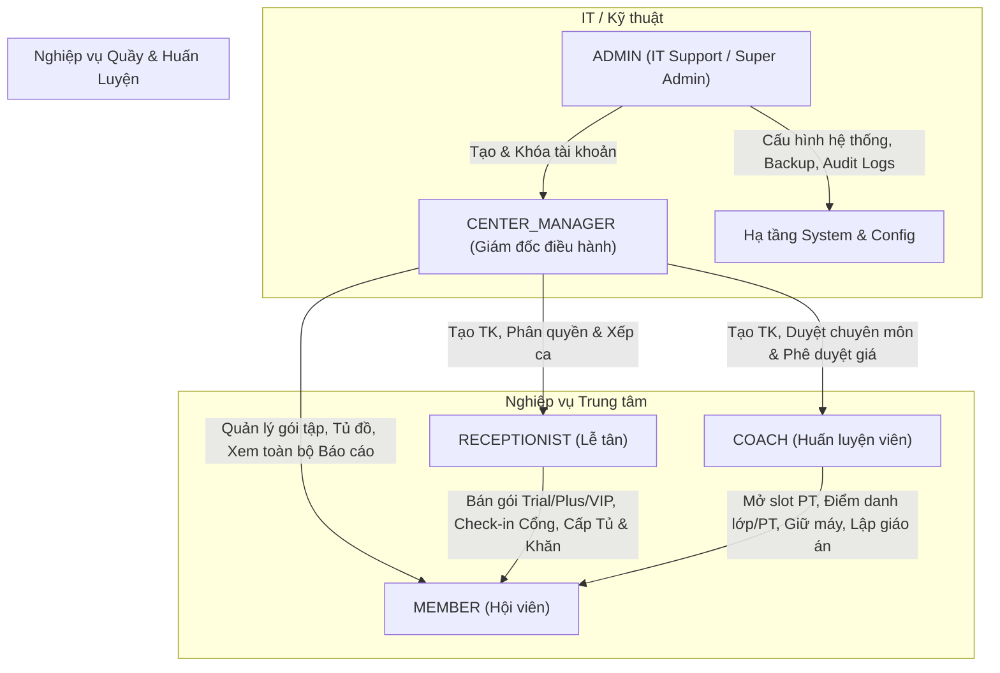

# KẾ HOẠCH TRIỂN KHAI BACKEND (V5 - PRODUCTION ALIGNED)
## SPORTS CENTER MANAGEMENT SYSTEM (GYM / BOXING / YOGA / DANCING)

> **Cập nhật:** Release 5.0 (Đồng bộ toàn diện với `SQL_v5.md`, `business_rule_final.md` và `implementation_plan.md`)  
> **Công nghệ:** NestJS + Prisma ORM + PostgreSQL 15+ (Supabase) + Redis 7 + Socket.io
> **Kiến trúc:** Modular Monolith (Clean Architecture)  
> **Quy mô nghiệp vụ:** Trung tâm thể thao cao cấp đa bộ môn với mô hình phân cấp quản trị 2 tầng (IT Admin & Center Manager), bán vé đa tầng (Trial, Drop-in, Plus, VIP, PT Add-on), kiểm soát đặt chỗ kép chống Overbooking & Race Condition, quản lý tiện ích hậu mãi (InBody Logs, Smart Locker, Towel Service) và trợ lý AI Workout RAG (pgvector).

---

## 1. CẤU TRÚC THƯ MỤC CHI TIẾT (TARGET PRODUCTION STRUCTURE)

```text
backend/
├── prisma/
│   ├── schema.prisma                  # 29 Models, Enums (đã đồng bộ 100% SQL_v5.md)
│   ├── migrations/                    # Lịch sử migration cơ sở dữ liệu Supabase
│   └── seed.ts                        # Seed data: Admin, Center Manager, 4 Disciplines, Specialties, Rooms, Lockers, Plans
├── src/
│   ├── common/                        # Thành phần chia sẻ dùng chung
│   │   ├── constants/                 # Error codes, system configs, business constraints
│   │   ├── decorators/                # @Roles(), @CurrentUser(), @Public()
│   │   ├── filters/                   # HttpExceptionFilter (Chuẩn hóa lỗi JSON)
│   │   ├── guards/                    # JwtAuthGuard, RolesGuard (RBAC 5 roles)
│   │   ├── interceptors/              # TransformResponseInterceptor, LoggingInterceptor
│   │   ├── pipes/                     # ValidationPipe
│   │   └── utils/                     # Date calculation helpers, advisory lock keys
│   ├── config/                        # Cấu hình môi trường (Supabase, Redis, JWT, AI API)
│   ├── database/                      # Prisma Module & Prisma Service
│   │   ├── prisma.module.ts
│   │   └── prisma.service.ts
│   ├── infrastructure/                # Các dịch vụ nền tảng bên ngoài
│   │   ├── redis/                     # Redis Client & Distributed Lock (Redlock)
│   │   ├── tasks/                     # Scheduler tương lai; chưa triển khai phase 6
│   │   ├── socket/                    # Socket.io Gateway (Realtime notifications & attendance)
│   │   └── storage/                   # Supabase Storage S3-compatible service
│   ├── modules/                       # Từng Module nghiệp vụ độc lập (Domain Modules)
│   │   ├── auth/                      # Đăng nhập, Refresh Token, Đăng xuất, Thu hồi session Redis
│   │   ├── users/                     # Quản lý tài khoản, Profile, Phân cấp 2 tầng (Admin tạo CM; CM tạo Staff/Coach)
│   │   ├── specialties/               # [V5 Mới] Quản lý danh mục chuyên môn HLV (Specialties) & gán Coach
│   │   ├── staff-shifts/              # Quản lý ca trực lễ tân, phân công ca, chống trùng lịch
│   │   ├── coach-rates/               # Quản lý cấu hình mức phí dạy của từng Coach theo thời kỳ
│   │   ├── coach-availability/        # [V5 Mới] Mở slot PT rảnh, chống xung đột chéo với lớp nhóm
│   │   ├── equipment/                 # Quản lý thiết bị máy tập, giữ chỗ máy cho ca dạy PT
│   │   ├── lockers/                   # [V5 Mới] Quản lý danh mục tủ đồ và cấp phát atomic theo lượt
│   │   ├── memberships/               # Quản lý Gói tập (Trial, Drop-in, Plus, VIP) 4 môn, hợp đồng hội viên
│   │   ├── classes/                   # 4 Bộ môn, Phòng tập, Lớp học nhóm, Lịch học cố định (Schedules)
│   │   ├── bookings/                  # Điều phối đặt chỗ kép:
│   │   │   ├── services/
│   │   │   │   ├── group-booking.service.ts  # Đặt lớp nhóm (Pessimistic lock FOR UPDATE trên schedules)
│   │   │   │   ├── pt-booking.service.ts     # Đặt PT 1-1 (Lock coach_availability, trừ remaining_pt_sessions)
│   │   │   │   └── cancellation.service.ts   # [V5 Mới] Hủy lịch phân tầng (<2h vs >=2h) & giải phóng tài nguyên
│   │   │   ├── bookings.controller.ts
│   │   │   └── dto/
│   │   ├── coach-cancellations/       # [V5 Mới] HLV Hủy Lịch Khẩn Cấp & Duyệt 2 Tầng (DSS):
│   │   │   ├── services/
│   │   │   │   ├── cancellation-request.service.ts # Coach nộp đơn xin nghỉ đột xuất (reasonMessage >= 20 ký tự)
│   │   │   │   └── cancellation-review.service.ts  # CM/Lễ tân duyệt, hoàn 100% quota cho Member & kích hoạt DSS
│   │   │   ├── coach-cancellations.controller.ts
│   │   │   └── dto/
│   │   ├── attendances/               # Điểm danh cổng (GATE_ENTRY + Locker + Towel) & Lớp/PT (CLASS_SESSION)
│   │   ├── inbody/                    # [V5 Mới] Quản lý lịch sử đo InBody định kỳ (cơ, mỡ, BMI)
│   │   ├── billing/                   # Hóa đơn (Snapshot Base/PT), Đăng ký VIP động, Mua thêm giờ PT (Add-on)
│   │   ├── analytics/                 # Báo cáo doanh thu tách biệt Base/PT, Tỷ lệ lấp đầy, Thống kê hội viên
│   │   └── ai-assistant/              # AI Workout Assistant, SSE Stream, RAG Vector Search (pgvector)
│   ├── app.module.ts                  # Root Module
│   └── main.ts                        # Entry point: CORS, Swagger (/docs), Global Pipes & Filters
├── test/                              # E2E test cho Concurrency Booking & Advisory Lock
├── Dockerfile                         # Multi-stage production build
├── docker-compose.yml                 # Redis 7 Alpine cục bộ
└── package.json
```

---

## 2. MA TRẬN PHÂN QUYỀN 2 TẦNG (RBAC MATRIX - 5 VAI TRÒ)



* **ADMIN (IT Support):**
  * Quản trị kỹ thuật cấp cao nhất, cấu hình API Keys, backup/restore, audit logs.
  * Tạo tài khoản duy nhất cho `CENTER_MANAGER`. Không can thiệp vào nghiệp vụ phòng tập hàng ngày.
* **CENTER_MANAGER (Giám đốc trung tâm):**
  * Quản trị toàn bộ nghiệp vụ: Tạo tài khoản và phân quyền cho `RECEPTIONIST`, `COACH`, `MEMBER`.
  * Cấu hình 4 môn (`disciplines`), danh mục chuyên môn (`specialties`), gói tập (`membership_plans`), phê duyệt giá HLV (`coach_rates`), quản lý tủ đồ (`lockers`).
  * **Ràng buộc an toàn:** Không thể tự nâng quyền lên `ADMIN`, không can thiệp vào tài khoản của `ADMIN`.
* **RECEPTIONIST (Lễ tân):** Bán/gia hạn gói tập (Trial, Drop-in, Plus, VIP, Add-on), xuất hóa đơn, check-in cổng (`GATE_ENTRY`), cấp phát tủ đồ theo lượt, phát khăn tập, nhập chỉ số InBody.
* **COACH (Huấn luyện viên):** Khai báo khung giờ rảnh PT (`coach_availability`), điểm danh lớp/ca PT (`CLASS_SESSION`), lập giáo án cá nhân hóa với RAG AI, giữ máy tập cho ca PT.
* **MEMBER (Hội viên):** Mua gói, xem biểu đồ InBody, theo dõi 2 quota độc lập (`remaining_group_sessions` và `remaining_pt_sessions`), đặt chỗ lớp nhóm hoặc đặt PT 1-1, hủy lịch trước 2 tiếng.

---

## 3. KẾ HOẠCH TRIỂN KHAI THEO GIAI ĐOẠN (PHASED IMPLEMENTATION PLAN V5)

### Phase 1: Môi trường, Hạ tầng & Lược đồ Database V5 (Tuần 1 - 2)
* Khởi tạo NestJS, cấu hình `.env` kết nối Supabase Pooler (`6543`), Direct (`5432`) và Docker Redis.
* **Đồng bộ hóa Prisma Schema (`prisma/schema.prisma`):**
  * Enums: `UserRole` (5 vai trò), `SubscriptionStatus`, `BookingStatus`, `AttendanceStatus`, `PaymentMethod`, `InvoiceStatus`, `TrainingMode` (`GROUP_CLASS`, `PERSONAL_TRAINING`, `HYBRID`, `CUSTOM`), `PackageTier` (`TRIAL`, `DROP_IN`, `PLUS`, `VIP`), `InvoiceType` (`SUBSCRIPTION_NEW`, `PT_ADDON`, `DROP_IN`), `LockerStatus` (`AVAILABLE`, `OCCUPIED`, `MAINTENANCE`), `CancellationRequestStatus` (`PENDING`, `APPROVED`, `REJECTED`), `CancellationTargetType` (`PERSONAL_TRAINING`, `GROUP_CLASS`).
  * Models mới: `Specialty`, `CoachSpecialty`, `MemberInbodyLog`, `Locker`, `LockerAssignment`, `CancellationRequest`, `CoachPenalty` (DSS).
  * Mở rộng Models hiện hữu:
    * `CoachProfile`: thêm `emergency_cancellation_count`, `monthly_emergency_cancellations`, `last_cancellation_reset_date`.
    * `MembershipPlan`: thêm `discipline_id`, `package_tier`, `training_mode`, `group_session_quota`, `pt_session_quota`, `unlimited_gym_entry`.
    * `UserSubscription`: thêm `discipline_id`, `package_tier`, `assigned_coach_id`, `remaining_group_sessions`, `remaining_pt_sessions`, `has_unlimited_gym_access`, **`frozen_at: DateTime?`** (mốc đóng băng thẻ — dùng để tính bù `end_date` khi unfreeze).
    * `Invoice`: thêm `type`, `base_amount`, `pt_amount`.
    * `Booking`: thêm `discipline_id`, `cancelled_at`, `is_late_cancellation`, `cancellation_reason`, `cancelled_by`, `is_emergency_cancellation`, **`subscription_id: String` (FK NOT NULL → `user_subscriptions.id RESTRICT`)** — trường then chốt để truy vết quota và hoàn lượt đúng hợp đồng.
    * `Schedule`: thêm **`status: ScheduleStatus` (default `OPEN`)** — dùng để đóng lớp khẩn cấp thay vì chỉ đặt `current_enrolled = 0`.
    * `Attendance`: thêm `towel_issued`.
  * Enum mới cần thêm: **`ScheduleStatus` (`OPEN`, `FULL`, `CANCELLED_BY_COACH`, `COMPLETED`)** — kiểm soát vòng đời lịch học; `BookingType` (`GROUP_CLASS`, `PERSONAL_TRAINING`); `CancellationTargetType` (`PERSONAL_TRAINING`, `GROUP_CLASS`).
* Viết script `prisma/seed.ts`:
  * Khởi tạo 4 môn (`GYM`, `BOXING`, `YOGA`, `DANCING`), các danh mục chuyên môn (`specialties`), danh mục tủ đồ (`lockers` Nam/Nữ/VIP), tài khoản Admin, Manager, Coaches, Lễ tân và các gói tập chuẩn theo ma trận kinh doanh.

### Phase 2: Xác thực & Phân quyền RBAC 2 tầng (Tuần 3)
* **Xác thực JWT & Session Redis:** Access Token (15 phút), Refresh Token (7 ngày) lưu trên Redis, hỗ trợ thu hồi token khi logout.
* **RBAC Guards:** `JwtAuthGuard`, `RolesGuard` với Decorator `@Roles()`, hỗ trợ `@Public()`.
* **Users Management (`UsersModule`):**
  * Quản lý hồ sơ `member_profiles`, `coach_profiles`.
  * Endpoint tạo tài khoản phân cấp: Admin tạo Center Manager; Center Manager tạo Receptionist, Coach.

### Phase 3: Quản trị Vận hành, Chuyên môn & Tiện ích Hậu mãi (Tuần 4 - 5)
* **`SpecialtiesModule`:** Quản lý danh mục kỹ thuật chuyên môn và liên kết HLV (`coach_specialties`).
* **`StaffShiftsModule` & `CoachRatesModule`:**
  * Lập lịch ca trực lễ tân (`staff_shifts`).
  * Cấu hình mức giá dạy theo buổi của từng Coach (`coach_rates`) theo khoảng thời gian hiệu lực `rate_range`.
* **`LockersModule`:**
  * Quản lý danh mục tủ đồ Nam/Nữ/VIP.
  * Cấp phát tủ đồ atomic khi check-in, giải phóng tủ khi check-out (`returned_at = NOW()`).
* **`InbodyModule`:**
  * Lưu trữ lịch sử đo chỉ số sinh học (`member_inbody_logs`).
  * Cung cấp API biểu đồ tiến trình cơ - mỡ cho Mobile App của Member và Coach.

### Phase 4: Điều phối Bán vé Đa tầng & Đặt lịch Kép (Tuần 6 - 7)
* **`BillingModule` & Gói tập 4 Môn:**
  * Xử lý đăng ký Gói VIP động: `total_amount = base_price + (12 * coach_rate)`. Gán `assigned_coach_id` và cấp 12 buổi PT.
  * Xử lý Mua thêm giờ PT lẻ (Add-on): Tạo hóa đơn `PT_ADDON` và cộng dồn `remaining_pt_sessions`.
  * Chặn cấu hình sai: Trigger DB chặn tạo gói GYM lớp nhóm.
  * **Quản lý vòng đời gói:**
    * **Đóng băng thẻ:** Lưu `frozen_at = NOW()`. Khi unfreeze: `end_date += (NOW() - frozen_at)`, xóa `frozen_at`.
    * **Gia hạn thẻ:** Nối tiếp từ `end_date` hiện tại (không kích hoạt ngay từ ngày gia hạn).
* **`BookingsModule` (Dual-Flow Engine):**
  * **Trường `subscription_id` bắt buộc** trong mọi luồng tạo booking. Khi tạo booking, tầng Service phải chọn hợp đồng phù hợp theo FIFO (ưu tiên `end_date` gần nhất còn hạn và đủ quota) rồi ghi `subscription_id = selectedSubscription.id`.
  * **Luồng 1 (Lớp nhóm Yoga/Boxing/Dance):** Dùng Pessimistic Locking (`SELECT ... FOR UPDATE`) trên `schedules`, kiểm tra `status = OPEN` AND `current_enrolled < capacity`, trừ `remaining_group_sessions` trên đúng `subscription_id` được chọn. Từ chối nếu `schedule.status != OPEN`.
  * **Luồng 2 (PT 1-1 Gym/Boxing/Yoga/Dance):** Dùng `pg_advisory_xact_lock` chống xung đột lịch Coach, khóa slot `is_booked = true`, trừ `remaining_pt_sessions` trên đúng `subscription_id` được chọn.
  * **Chính sách PT đã triển khai:** Không giới hạn 3 buổi/tuần. Trong thời hạn gói, MEMBER được đặt linh hoạt đến khi hết `remaining_pt_sessions`; PT add-on cộng thêm lượt vào đúng subscription ACTIVE nhưng không kéo dài ngày hết hạn. Tối đa một buổi PT cho mỗi cặp MEMBER + môn + ngày theo `Asia/Ho_Chi_Minh`; hai môn khác nhau trong cùng ngày được phép nếu thời gian không trùng. `BookingsService` kiểm tra giới hạn ngày và đặt lại sau hủy trong transaction dưới khóa hội viên; FE chỉ phản ánh trạng thái, không thay thế kiểm tra server. Sau hủy đúng hạn, hoàn quota nhưng chỉ đặt lại vào ngày khác của cùng môn.
  * **Dịch vụ Hủy lịch Hội viên (`cancellation.service.ts` - Tiered Policy):** Luôn cho phép hủy trước giờ bắt đầu để giải phóng slot lớp/HLV/máy tập; Kiểm tra $\Delta t \ge 2\text{ tiếng} \rightarrow$ Hoàn lại session vào **đúng `booking.subscription_id`** (không dùng `updateMany` theo `userId/discipline/coach`); Nếu $< 2\text{ tiếng} \rightarrow$ Không hoàn session (tính mất lượt). Chặn hủy nếu buổi tập đã bắt đầu.
  * **Dịch vụ HLV Hủy Ca Khẩn Cấp & Duyệt 2 Tầng (`cancellation-review.service.ts` - DSS):**
    * HLV nộp đơn kèm lời nhắn $\ge 20$ ký tự $\rightarrow$ Phát Realtime tới Web CM (W06) và Quầy Lễ tân (W13).
    * Quản lý hoặc Lễ tân quầy duyệt: claim yêu cầu bằng `updateMany({ where: { id, status: PENDING } })`, chỉ xử lý tiếp khi `count = 1`. Cả APPROVE và REJECT dùng cùng cơ chế. Transaction dùng Serializable, retry toàn bộ tối đa 3 lần khi P2034.
    * Trong transaction: chỉ hoàn quota cho booking chuyển được từ `CONFIRMED/PENDING` sang `CANCELLED`; hoàn vào **`booking.subscriptionId`**. Đặt **`coachAvailability.isBooked = false` và `isEmergencyCancelled = true`**, giải phóng thiết bị, ghi audit (cờ override chỉ bật cho lễ tân), đóng lớp bằng **`CANCELLED_BY_COACH`**, giảm sĩ số theo số booking thực sự hủy được và ghi DSS.
    * DB tự suy ra `OPEN/FULL` từ `current_enrolled/capacity`. Service tăng/giảm sĩ số đúng một lần; trigger không tự tăng/giảm từ booking. Partial GiST chỉ xét `OPEN/FULL`, nên lịch đã đóng không giữ phòng/HLV và không cần xóa lịch sử.
    * Yoga VIP chuẩn: base **1.000.000đ / 30 ngày / 15 buổi nhóm + 12 PT**; seed cập nhật được cả bản ghi đã tồn tại.

### Quy trình đồng bộ DB V5
* Dev: `npm run db:setup` (Prisma db push → SQL V5 trên DIRECT_URL → seed), dừng khi bất kỳ bước nào lỗi.
* SQL đặc thù: `npm run db:constraints`; chạy sau mỗi cập nhật/reset schema. Script SQL chạy nguyên tử trong transaction.
* CI/Production: migration schema đã review → `prisma migrate deploy` → `npm run db:constraints`. Các migration lịch sử chưa đầy đủ model V5; phải bổ sung migration schema trước khi dựng DB mới bằng migrate deploy.
* Kiểm thử PostgreSQL: `npm run db:verify:v5`, dùng schema riêng và dọn sau kiểm thử.

### Phase 5: Điểm danh Realtime & Tiện ích Quầy (Tuần 8)
* **`AttendancesModule`:**
  * Điểm danh cổng (`GATE_ENTRY`): Xác thực gói tập còn hạn $\rightarrow$ Cấp tủ đồ tự động qua `FOR UPDATE SKIP LOCKED` $\rightarrow$ Ghi nhận mượn khăn `towel_issued`.
  * Điểm danh lớp/ca PT (`CLASS_SESSION`): Huấn luyện viên kiểm diện từ Mobile App (`PRESENT`, `ABSENT`, `LATE`).
* **Realtime Gateway (`SocketGateway`):**
  * Bắn sự kiện realtime cập nhật sĩ số lớp học và thông báo khách vào cổng lên Web Portal của Lễ tân & Manager.

### Phase 6: Trợ lý AI Streaming & Tác vụ định kỳ (Tuần 9 - 10)
* **`AiAssistantModule`:**
  * Endpoint SSE streaming văn bản gợi ý bài tập từ LLM API (Gemini/OpenAI).
  * RAG pgvector trên `exercise_knowledge` (Cosine Distance `<=>`) kết hợp với dữ liệu InBody và hồ sơ bệnh án của học viên để tạo giáo án cá nhân hóa.
* **Scheduler Module (dự kiến @nestjs/schedule, không dùng BullMQ):**
  * **Cronjob Expiry (00:05 hàng ngày):** Quét các hợp đồng có `end_date < CURRENT_DATE` để cập nhật `status = 'EXPIRED'` (giữ nguyên số dư quota lịch sử).
  * **Notification Task:** Nhắc lịch nhóm/PT trước 2 tiếng qua FCM; chống trùng, lưu kết quả, chạy bù. Nếu cần retry bền vững, lưu tác vụ trong PostgreSQL; chưa triển khai.

Scheduler dùng timezone `Asia/HoChiMinh`, thao tác idempotent và chạy bù sau restart; không bảo đảm tác vụ bằng bộ nhớ đơn thuần. Redis chỉ phục vụ authentication. Chi tiết triển khai: [backend_deployment_new.md](./backend_deployment_new.md).

### Phase 7: Kiểm thử Concurrency, Tối ưu & Đóng gói Production (Tuần 11 - 12)
* **Kiểm thử E2E & Concurrency:**
  * Test 20 requests đồng thời tranh chấp 1 slot lớp nhóm cuối cùng.
  * Test race condition 2 request đồng thời mở ca dạy lớp nhóm và slot PT của cùng 1 HLV.
  * Test race condition 2 lễ tân cùng cấp 1 tủ đồ.
* **Đóng gói Docker:** Multi-stage `Dockerfile` tối ưu kích thước image và cấu hình Nginx Reverse Proxy.
