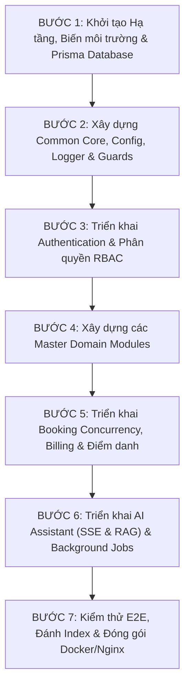

# HƯỚNG DẪN TUẦN TỰ CÁC BƯỚC TRIỂN KHAI HỆ THỐNG BACKEND
## SPORTS CENTER MANAGEMENT SYSTEM

Tài liệu này đóng vai trò là kim chỉ nam chi tiết và tuần tự (step-by-step implementation instructions) để đội ngũ kỹ sư triển khai toàn bộ hệ sinh thái Backend cho **Sports Center Management System**, dựa trên các thông số kỹ thuật được xác lập tại [README.md](file:///D:/FPT/FA26/WDP301/app/backend/README.md), [implementation_plan_backend.md](file:///D:/FPT/FA26/WDP301/app/backend/markdown/implementation_plan_backend.md) và thiết kế cơ sở dữ liệu [erd_SQL_v2.md](file:///D:/FPT/FA26/WDP301/app/backend/markdown/erd_SQL_v2.md).

---

## TỔNG QUAN CÔNG NGHỆ & KIẾN TRÚC

* **Core Framework:** NestJS (Node.js v20+ LTS, TypeScript)
* **Architecture:** Modular Monolith theo Clean Architecture
* **Database & ORM:** PostgreSQL 15+ (Supabase Transaction Pooler cổng 6543, Direct cổng 5432) + Prisma ORM + pgvector
* **Cache & Lock:** Redis 7.x (IoRedis, Redlock)
* **Background Queue:** BullMQ
* **Realtime:** Socket.io Gateway
* **AI Engine:** Google Gemini API (hoặc OpenAI) với Server-Sent Events (SSE) Streaming
* **Authentication & Authorization:** JWT (Access/Refresh Token) + Role-Based Access Control (RBAC 4 roles: `MANAGER`, `COACH`, `RECEPTIONIST`, `MEMBER`)

---

## QUY TRÌNH TRIỂN KHAI TUẦN TỰ (7 BƯỚC)



---

### BƯỚC 1: Khởi tạo Hạ tầng, Biến môi trường & Prisma Database

Mục tiêu: Thiết lập kết nối cơ sở dữ liệu Supabase, Redis, và chuẩn hóa schema dữ liệu.

1. **Thiết lập biến môi trường (`.env`):**
   * Tạo file `.env` từ `.env.example` với đầy đủ các cấu hình:
     * `PORT=3000`, `NODE_ENV=development`
     * `DATABASE_URL`: Connection string Supabase Session/Transaction Pooler (cổng 6543, `pgbouncer=true`).
     * `DIRECT_URL`: Connection string kết nối trực tiếp Supabase PostgreSQL (cổng 5432) phục vụ migration.
     * `REDIS_HOST`, `REDIS_PORT`, `REDIS_PASSWORD`.
     * `JWT_ACCESS_SECRET`, `JWT_ACCESS_EXPIRES_IN=15m`, `JWT_REFRESH_SECRET`, `JWT_REFRESH_EXPIRES_IN=7d`.
     * `GEMINI_API_KEY` hoặc OpenAI API Key.
2. **Khởi chạy Redis phục vụ môi trường Local:**
   * Tạo file `docker-compose.yml` chứa service Redis 7-alpine.
   * Lệnh: `docker-compose up -d redis`.
3. **Mô hình hóa dữ liệu trong `prisma/schema.prisma`:**
   * Chuyển đổi toàn bộ schema từ [erd_SQL_v2.md](file:///D:/FPT/FA26/WDP301/app/backend/markdown/erd_SQL_v2.md) sang định dạng Prisma:
     * Enums: `UserRole`, `SubscriptionStatus`, `BookingStatus`, `AttendanceStatus`, `PaymentMethod`, `InvoiceStatus`.
     * Entities: `User`, `MemberProfile`, `CoachProfile`, `MembershipPlan`, `UserSubscription`, `Invoice`, `Discipline`, `Room`, `Class`, `Schedule`, `Booking`, `Attendance`, `WorkoutPlan`, `WorkoutExercise`, `ExerciseKnowledge`, `AuditLog`.
     * Đảm bảo cấu hình quan hệ Foreign Key (1-1, 1-N, N-N) và Unique constraints.
4. **Chạy Migration & Seed Database:**
   * Kích hoạt extensions PostgreSQL (trong SQL migration): `btree_gist`, `vector`.
   * Chạy lệnh tạo migration:
     ```bash
     npx prisma migrate dev --name init_core_schema
     ```
   * Viết file `prisma/seed.ts`:
     * Tạo tài khoản mặc định hash bcrypt: 1 Manager, 2 Coaches, 1 Receptionist, 2 Members.
     * Tạo dữ liệu mẫu: Bộ môn (Gym, Yoga, Boxing), Phòng tập (Room A, Room B), Gói tập (Gói tháng, Gói 3 tháng, Gói kèm PT).
   * Chạy seed: `npx ts-node prisma/seed.ts` hoặc cấu hình script `npm run prisma:seed`.
5. **Tạo `PrismaModule` & `PrismaService`:**
   * Tạo thư mục `src/database/` với `PrismaService` kế thừa `PrismaClient` và quản lý lifecycle `onModuleInit` / `enableShutdownHooks`.

---

### BƯỚC 2: Xây dựng Common Core, Config, Logger & Guards

Mục tiêu: Đóng gói các lớp nền tảng dùng chung (Shared Kernel) theo chuẩn Clean Architecture.

1. **ConfigModule & Validation:**
   * Cài đặt và tích hợp `@nestjs/config` trong `AppModule`.
   * Viết file validation schema cho environment variables (sử dụng Joi hoặc Zod).
2. **Infrastructure Providers:**
   * `src/infrastructure/redis/`: Tạo `RedisModule` cung cấp kết nối `ioredis` và Redlock service cho Distributed Locks.
   * `src/infrastructure/queue/`: Cấu hình `@nestjs/bullmq` kết nối tới Redis instance.
   * `src/infrastructure/socket/`: Cấu hình Socket.io Gateway phục vụ bắn event realtime về client.
3. **Common Utilities & Interceptors:**
   * `src/common/filters/http-exception.filter.ts`: Chuẩn hóa response lỗi trả về đồng nhất theo mẫu:
     ```json
     {
       "success": false,
       "statusCode": 400,
       "message": "Chi tiết lỗi",
       "timestamp": "2026-09-12T...",
       "path": "/api/v1/..."
     }
     ```
   * `src/common/interceptors/transform-response.interceptor.ts`: Chuẩn hóa response thành công: `{ success: true, data: ..., timestamp: ... }`.
   * `src/common/interceptors/logging.interceptor.ts`: Ghi log thời gian thực thi (execution latency) của các API request.
4. **Validation Pipes & Global Setup:**
   * Cấu hình toàn cục trong [src/main.ts](file:///D:/FPT/FA26/WDP301/app/backend/src/main.ts):
     * Kích hoạt `ValidationPipe` với `{ whitelist: true, transform: true, forbidNonWhitelisted: true }`.
     * Kích hoạt CORS hỗ trợ Web & Mobile clients.
     * Cài đặt Swagger UI tại endpoint `/docs` qua `@nestjs/swagger`.
     * Đặt global prefix `api/v1`.

---

### BƯỚC 3: Triển khai Authentication & Phân quyền RBAC

Mục tiêu: Xây dựng cơ chế đăng nhập bảo mật và hệ thống phân quyền 4 Roles.

1. **Module `AuthModule` (`src/modules/auth`):**
   * DTOs: `LoginDto`, `RefreshTokenDto`, `RegisterDto`.
   * `AuthService`:
     * Logic xác thực email & so khớp `password_hash` với bcrypt.
     * Cấp phát cặp JWT: `accessToken` (thời hạn ngắn, vd: 15 phút) chứa `{ sub, email, role }` và `refreshToken` (thời hạn dài, vd: 7 ngày) được lưu trữ băm hoặc kiểm tra phiên tại Redis/Database.
     * Endpoint làm mới token: `POST /api/v1/auth/refresh`.
     * Endpoint đăng xuất và thu hồi Refresh Token.
2. **Passport Strategies & Guards:**
   * `src/modules/auth/strategies/jwt.strategy.ts`: Trích xuất Bearer Token từ header request.
   * `src/common/guards/jwt-auth.guard.ts`: Bảo vệ các private endpoints (ngoại trừ các endpoint gắn decorator `@Public()`).
   * `src/common/decorators/roles.decorator.ts`: Decorator `@Roles('MANAGER', 'COACH', 'RECEPTIONIST', 'MEMBER')`.
   * `src/common/guards/roles.guard.ts`: Đọc metadata role từ decorator và so khớp với `req.user.role`.
   * `src/common/decorators/current-user.decorator.ts`: Trích xuất payload người dùng hiện tại từ context.

---

### BƯỚC 4: Xây dựng các Master Domain Modules (Users, Memberships, Classes)

Mục tiêu: Cung cấp API quản lý thực thể nền tảng cho Manager, Coach và Receptionist.

1. **`UsersModule` (`src/modules/users`):**
   * Quản lý CRUD tài khoản người dùng theo Roles.
   * Quản lý hồ sơ thể trạng hội viên (`member_profiles`: chiều cao, cân nặng, BMI, body fat, mục tiêu tập luyện).
   * Quản lý hồ sơ huấn luyện viên (`coach_profiles`: chuyên môn, bio, chứng chỉ, năm kinh nghiệm).
2. **`MembershipsModule` (`src/modules/memberships`):**
   * CRUD các gói tập (`membership_plans`: tên gói, số ngày hiệu lực, định mức buổi tập session quota, đơn giá).
   * Bán gói tập và cấp thẻ cho hội viên (`user_subscriptions`).
   * Nghiệp vụ đóng băng gói tập (`FROZEN`) và gia hạn gói tập.
3. **`ClassesModule` (`src/modules/classes`):**
   * Quản lý bộ môn thể thao (`disciplines`).
   * Quản lý phòng tập (`rooms`: tên phòng, sức chứa tối đa `capacity`).
   * Quản lý lớp học (`classes`) trực thuộc bộ môn.
   * Quản lý lịch học (`schedules`):
     * Thiết lập lịch theo khung giờ (`start_time`, `end_time`), phòng tập, HLV đứng lớp.
     * **Validation bắt buộc:** Kiểm tra xung đột thời gian (overlap) giữa phòng tập và huấn luyện viên thông qua PostgreSQL Exclusion Constraints hoặc transaction kiểm tra thời gian thực.

---

### BƯỚC 5: Triển khai Booking Concurrency, Billing & Điểm danh

Mục tiêu: Đảm bảo tính toàn vẹn tuyệt đối (ACID) khi đặt lịch, không bị overbooking, và số hóa quy trình điểm danh tại quầy & lớp.

1. **`BookingsModule` (`src/modules/bookings`):**
   * **Nghiệp vụ Đặt lớp (Book Class Slot):**
     * Kiểm tra trạng thái gói tập của hội viên (`ACTIVE` và `remaining_sessions > 0` nếu có quota).
     * Kiểm tra trùng lịch đặt của chính hội viên.
     * **Xử lý Race Condition & Overbooking:** Áp dụng Pessimistic Locking hoặc Prisma Interactive Transaction:
       ```typescript
       await prisma.$transaction(async (tx) => {
         // Lock bản ghi schedule với FOR UPDATE
         const schedule = await tx.$queryRaw`
           SELECT * FROM schedules WHERE id = ${scheduleId}::uuid FOR UPDATE
         `;
         if (schedule.current_enrolled >= schedule.capacity) {
           throw new BadRequestException('Lớp học đã kín chỗ!');
         }
         // Tạo booking và cập nhật current_enrolled
         await tx.booking.create({ ... });
         await tx.schedule.update({
           where: { id: scheduleId },
           data: { current_enrolled: { increment: 1 } },
         });
         // Trừ session nếu gói tính theo buổi
       });
       ```
   * **Nghiệp vụ Hủy chỗ (Cancel Booking):** Hoàn trả lại slot cho lớp và cộng lại buổi tập cho hội viên nếu hủy trước thời hạn quy định.
2. **`BillingModule` (`src/modules/billing`):**
   * Tự động tạo mã hóa đơn duy nhất (`invoice_code`).
   * Ghi nhận giao dịch thanh toán: phương thức thanh toán (`CASH`, `BANK_TRANSFER`, `CARD`), nhân viên thu ngân (`issuer_id`).
   * API xuất thông tin hóa đơn cho hội viên và quản lý doanh thu.
3. **`AttendancesModule` (`src/modules/attendances`):**
   * Điểm danh tại cổng vào trung tâm (`checkin_type = 'GATE_ENTRY'`): do Lễ tân hoặc cổng quét QR thực hiện.
   * Điểm danh tại lớp học (`checkin_type = 'CLASS_SESSION'`): do Huấn luyện viên kiểm diện từ Mobile App.
   * Tích hợp `SocketGateway` để đẩy thông báo realtime: Khi HLV điểm danh trên mobile, màn hình dashboard của Lễ tân và Manager được cập nhật ngay lập tức.

---

### BƯỚC 6: Triển khai AI Assistant (SSE & RAG) & Background Jobs

Mục tiêu: Xây dựng tính năng trợ lý thông minh và hệ thống tác vụ nền tự động.

1. **`AiAssistantModule` (`src/modules/ai-assistant`):**
   * Tích hợp SDK Gemini/OpenAI.
   * **SSE (Server-Sent Events) Endpoint:**
     * Endpoint `GET /api/v1/ai-assistant/chat-stream` trả về `Observable<MessageEvent>` để frontend nhận token chữ dạng gõ phím theo thời gian thực mà không bị timeout.
   * **RAG với pgvector:**
     * Bảng `exercise_knowledge` lưu trữ bài tập và vector embedding (`VECTOR(1536)`).
     * Sử dụng toán tử Cosine Distance `<=>` để truy vấn top bài tập phù hợp nhất với mục tiêu tập luyện, tiền sử chấn thương và thể trạng của hội viên.
     * Sinh giáo án gợi ý cho Huấn luyện viên lưu vào `workout_plans` và `workout_exercises`.
2. **BullMQ Background Jobs & Schedulers:**
   * **Expire Subscriptions Cronjob:** Chạy định kỳ lúc 00:00 hàng ngày, quét các `user_subscriptions` có `end_date < CURRENT_DATE` và trạng thái `ACTIVE` để cập nhật thành `EXPIRED`.
   * **Class Reminder Notification Worker:** Hàng đợi gửi thông báo nhắc lịch học trước 2 giờ cho học viên có lịch học sắp diễn ra.
3. **`AnalyticsModule` (`src/modules/analytics`):**
   * Báo cáo doanh thu theo ngày, tuần, tháng và theo gói tập.
   * Thống kê tỷ lệ lấp đầy (utilization rate) theo từng phòng tập và khung giờ.
   * Thống kê tỷ lệ hội viên chuyên cần / bỏ lớp.

---

### BƯỚC 7: Kiểm thử E2E, Đánh Index & Đóng gói Docker/Nginx

Mục tiêu: Đảm bảo khả năng chịu tải, hiệu năng truy vấn và đóng gói sẵn sàng cho Production.

1. **Kiểm thử Tích hợp & Concurrency:**
   * Viết E2E tests với Jest & Supertest tại thư mục `test/`:
     * Luồng Authenticate & RBAC.
     * Concurrency test: Mô phỏng 20 requests đồng thời đăng ký vào 1 lớp chỉ còn 1 chỗ trống duy nhất (đảm bảo đúng 1 request thành công, 19 requests báo lỗi `Class Full`, số lượng `current_enrolled` không vượt quá `capacity`).
2. **Tối ưu hóa Cơ sở dữ liệu (Database Indexing):**
   * Đảm bảo khởi tạo 20 explicit indexes đã định nghĩa trong [erd_SQL_v2.md](file:///D:/FPT/FA26/WDP301/app/backend/markdown/erd_SQL_v2.md):
     * Index cho Foreign Keys: `idx_user_subscriptions_user_id`, `idx_bookings_schedule_id`, v.v.
     * Partial Unique Index: `uq_active_class_booking` ngăn ngừa duplicate booking active.
     * Vector IVFFlat Index: `idx_exercise_knowledge_embedding` tăng tốc độ tìm kiếm vector.
3. **Đóng gói Docker & Production Configuration:**
   * Xây dựng `Dockerfile` đa tầng (Multi-stage build):
     * Stage 1: Dependency resolution & build TypeScript sang JavaScript (`dist/`).
     * Stage 2: Production runtime chỉ chứa `dist/`, `node_modules` production và prisma engine.
   * Tạo `docker-compose.prod.yml` gồm Backend API, Redis và Reverse Proxy Nginx (cấu hình SSL/TLS, gzip, SSE streaming buffering off).
4. **Tài liệu bàn giao:**
   * Xuất bản Swagger UI hoàn chỉnh.
   * Kiểm tra mã nguồn với `npm run lint` (`oxlint` / `eslint`).

---

## BẢNG PHÂN CÔNG CHECKLIST THEO GIAI ĐOẠN

| Bước | Hạng mục thực hiện chính | Đầu ra (Deliverables) |
| :--- | :--- | :--- |
| **Bước 1** | Setup môi trường, Docker Compose Redis, Prisma Schema & Seed | `prisma/schema.prisma`, `seed.ts`, Migrations thành công |
| **Bước 2** | Shared Kernel: Filters, Interceptors, Pipes, Swagger, Config | `src/common/`, `src/config/`, Swagger UI hoạt động |
| **Bước 3** | Authentication & RBAC (Manager, Coach, Receptionist, Member) | `src/modules/auth/`, `@Roles()`, `JwtAuthGuard`, `RolesGuard` |
| **Bước 4** | Master Data Modules (Users, Memberships, Classes & Schedules) | `src/modules/users/`, `memberships/`, `classes/` CRUD APIs |
| **Bước 5** | Transaction Booking (Anti-overbooking), Billing & Attendances | `src/modules/bookings/` (Lock slot), `billing/`, `attendances/` |
| **Bước 6** | AI Assistant (SSE Stream, RAG pgvector), BullMQ Background Jobs | `src/modules/ai-assistant/`, BullMQ Queues, Cronjobs |
| **Bước 7** | Concurrency Test, Indexing Database, Multi-stage Dockerfile | E2E Concurrency Test pass, Docker image build sẵn sàng |

---

*Tài liệu này được soạn thảo và kiểm duyệt dựa trên kiến trúc chuẩn của dự án Sports Center Management System Backend.*
