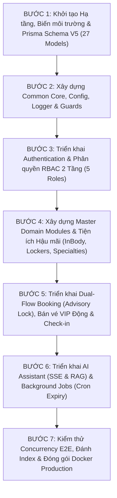

# HƯỚNG DẪN TUẦN TỰ CÁC BƯỚC TRIỂN KHAI BACKEND (V5 PRODUCTION)
## SPORTS CENTER MANAGEMENT SYSTEM (GYM / BOXING / YOGA / DANCING)

Tài liệu này là kim chỉ nam chi tiết và tuần tự (step-by-step implementation guide) dành cho đội ngũ kỹ sư backend triển khai hệ thống bám sát thiết kế cơ sở dữ liệu **PostgreSQL 15+ Schema V5** (`SQL_v5.md`), quy tắc nghiệp vụ hoàn chỉnh (`business_rule_final.md`) và kế hoạch triển khai tổng thể (`implementation_plan.md`).

---

## TỔNG QUAN CÔNG NGHỆ & NỀN TẢNG V5

* **Core Framework:** NestJS (Node.js LTS v20+, TypeScript)
* **Architecture:** Modular Monolith theo Clean Architecture
* **Database & ORM:** PostgreSQL 15+ (Supabase) + Prisma ORM 5.22.0 + pgvector + btree_gist
* **Zero-Trust Security:** Row Level Security (RLS) trên toàn bộ 27 bảng
* **Cache & Lock:** Redis 7 (IoRedis, Redlock) & PostgreSQL Advisory Locks
* **Background Queue:** BullMQ (Cronjobs & FCM Notification)
* **Realtime:** Socket.io Gateway
* **AI Engine:** Google Gemini / OpenAI kết hợp RAG Vector Search (1536 chiều)
* **Authentication & Authorization:** JWT + RBAC 5 vai trò (`ADMIN`, `CENTER_MANAGER`, `COACH`, `RECEPTIONIST`, `MEMBER`)

---

## QUY TRÌNH TRIỂN KHAI TUẦN TỰ (7 BƯỚC)

---

### BƯỚC 1: Khởi tạo Hạ tầng, Biến môi trường & Prisma Schema V5

Mục tiêu: Thiết lập kết nối Supabase, Redis, và chuẩn hóa 27 Models trong Prisma Schema.

1. **Thiết lập biến môi trường (`.env`):**
   * Đảm bảo cấu hình đúng:
     * `DATABASE_URL`: Connection string Supabase Pooler cổng 6543 (`?pgbouncer=true`).
     * `DIRECT_URL`: Connection string kết nối trực tiếp cổng 5432 phục vụ migration.
     * `REDIS_HOST`, `REDIS_PORT`, `REDIS_PASSWORD`.
     * `JWT_ACCESS_SECRET`, `JWT_REFRESH_SECRET`.
     * `GEMINI_API_KEY` hoặc OpenAI API Key.
2. **Khởi chạy Redis Local:**
   * Sử dụng Docker Compose: `docker-compose up -d redis`.
3. **Mô hình hóa dữ liệu trong `prisma/schema.prisma`:**
   * Cập nhật đầy đủ 27 Models tương thích 100% với `SQL_v5.md`:
     * Enums: `UserRole` (5 roles), `SubscriptionStatus`, `BookingStatus`, `AttendanceStatus`, `PaymentMethod`, `InvoiceStatus`, `TrainingMode`, `PackageTier`, `InvoiceType`, `LockerStatus`.
     * Các bảng nghiệp vụ mới: `Specialty`, `CoachSpecialty`, `MemberInbodyLog`, `Locker`, `LockerAssignment`.
     * Mở rộng `UserSubscription`: bổ sung `discipline_id`, `package_tier`, `assigned_coach_id`, `remaining_group_sessions`, `remaining_pt_sessions`, `has_unlimited_gym_access`.
     * Mở rộng `MembershipPlan`: bổ sung `discipline_id`, `package_tier`, `training_mode`, `group_session_quota`, `pt_session_quota`, `unlimited_gym_entry`.
4. **Seed Database (`prisma/seed.ts`):**
   * Khởi tạo: 4 Bộ môn (`GYM`, `BOXING`, `YOGA`, `DANCING`), các danh mục chuyên môn `specialties`, danh mục tủ đồ `lockers`, 1 Admin, 1 Center Manager, 2 Coaches, 1 Receptionist, 2 Members và các gói tập mẫu (Trial, Plus, VIP).

---

### BƯỚC 2: Xây dựng Common Core, Config, Logger & Guards

Mục tiêu: Đóng gói các lớp nền tảng dùng chung (Shared Kernel) theo chuẩn Clean Architecture.

1. **ConfigModule & Validation:**
   * Kiểm tra biến môi trường nghiêm ngặt với `env.validation.ts`.
2. **Infrastructure Providers:**
   * `src/infrastructure/redis/`: Redis client wrapper cho Cache và Redlock.
   * `src/infrastructure/queue/`: Cấu hình BullMQ kết nối Redis.
   * `src/infrastructure/socket/`: Cấu hình Socket.io Gateway.
3. **Common Utilities & Interceptors:**
   * `HttpExceptionFilter`: Chuẩn hóa response lỗi trả về `{ success: false, statusCode, errorCode, message, timestamp, path }`.
   * `TransformResponseInterceptor`: Chuẩn hóa response thành công `{ success: true, statusCode, data, timestamp }`.
   * `LoggingInterceptor`: Đo lường latency từng request HTTP.
4. **Global Setup (`src/main.ts`):**
   * Bật `ValidationPipe` toàn cục (`whitelist: true, transform: true`).
   * Cài đặt Swagger UI tại endpoint `/docs`.
   * Global prefix: `/api/v1`.

---

### BƯỚC 3: Triển khai Authentication & Phân quyền RBAC 2 Tầng

Mục tiêu: Xây dựng cơ chế đăng nhập bảo mật và hệ thống phân quyền 5 Roles.

1. **Module `AuthModule` (`src/modules/auth`):**
   * DTOs: `LoginDto`, `RefreshTokenDto`, `RegisterDto`.
   * Cấp phát cặp JWT: `accessToken` (15 phút) và `refreshToken` (7 ngày) lưu trên Redis với TTL.
   * Endpoint đăng xuất (`logout`) thu hồi Refresh Token trên Redis.
2. **Passport Strategies & RBAC Guards:**
   * `JwtAuthGuard`: Bảo vệ endpoint private (ngoại trừ `@Public()`).
   * `RolesGuard`: So khớp quyền truy cập dựa trên `@Roles('ADMIN', 'CENTER_MANAGER', 'COACH', 'RECEPTIONIST', 'MEMBER')`.
3. **Users Management (`UsersModule`):**
   * Phân cấp tạo tài khoản: Admin tạo Center Manager; Center Manager tạo Receptionist và Coach.
   * Quản lý hồ sơ `member_profiles`, `coach_profiles`.

---

### BƯỚC 4: Master Domain Modules & Tiện ích Hậu mãi (InBody, Lockers, Specialties)

Mục tiêu: Cung cấp API quản lý thực thể nền tảng và dịch vụ giá trị gia tăng cho hội viên.

1. **`SpecialtiesModule`:**
   * Quản lý danh mục kỹ thuật chuyên môn theo từng môn thể thao (`specialties`).
   * Gán và cập nhật chuyên môn cho Coach (`coach_specialties`).
2. **`LockersModule`:**
   * Quản lý danh mục tủ đồ (`lockers`: khu Nam, khu Nữ, VIP).
   * Cấp phát tủ đồ theo lượt check-in (`locker_assignments`), kiểm tra an toàn concurrency qua Partial Unique Index `uq_locker_single_active_assignment`.
3. **`InbodyModule`:**
   * Ghi nhận lịch sử đo chỉ số sinh học (`member_inbody_logs`: chiều cao, cân nặng, khối lượng cơ, % mỡ, BMI, mỡ nội tạng).
   * Cung cấp API biểu đồ tiến trình tập luyện cho Member và Coach.
4. **`StaffShiftsModule` & `CoachRatesModule`:**
   * Phân ca trực lễ tân (`staff_shifts`) và cấu hình biểu phí HLV theo giờ (`coach_rates`).

---

### BƯỚC 5: Triển khai Dual-Flow Booking (Advisory Lock), Bán vé VIP Động & Check-in

Mục tiêu: Xử lý giao dịch bán vé phức hợp và kiểm soát đặt lịch kép chống Overbooking & Race Condition.

1. **Bán vé & Đăng ký Gói tập (`BillingModule` & `MembershipsModule`):**
   * **Gói VIP Động:** Tính tiền tự động: `total_amount = base_price + (12 * coach_rate)`. Gán `assigned_coach_id`, cấp 12 buổi PT và hạn mức lớp nhóm tương ứng.
   * **Mua thêm giờ PT (Add-on Top-up):** Tạo hóa đơn loại `PT_ADDON` và cộng dồn vào `user_subscriptions.remaining_pt_sessions`.
   * **Chống lạm dụng Free Trial:** Chặn đăng ký Trial lần 2 cho cùng 1 môn qua Partial Unique Index `uq_user_single_trial_per_discipline`.
2. **`BookingsModule` (Dual-Flow Booking Engine):**
   * **Luồng 1 (Lớp nhóm Yoga/Boxing/Dancing):**
     * Sử dụng Pessimistic Locking (`SELECT ... FOR UPDATE`) trên bản ghi `schedules`.
     * Kiểm tra `current_enrolled < capacity`, trừ `remaining_group_sessions`, tăng `current_enrolled`.
   * **Luồng 2 (PT 1-1 Gym/Boxing/Yoga/Dancing):**
     * Sử dụng **PostgreSQL Advisory Lock (`pg_advisory_xact_lock`)** theo `coach_id` để chống xung đột chéo giữa lịch lớp nhóm và slot PT.
     * Khóa slot `coach_availability.is_booked = true`, trừ `remaining_pt_sessions`.
   * **Hủy lịch trước 2 tiếng (`cancellation.service.ts`):**
     * Nếu thời gian hủy $\ge 2$ tiếng trước giờ tập $\rightarrow$ Chuyển booking sang `CANCELLED`, hoàn lại 1 session cho hội viên, mở lại slot.
     * Nếu dưới 2 tiếng $\rightarrow$ Ném lỗi `BadRequestException('Quá hạn hủy chỗ')`.
3. **`AttendancesModule` (Check-in Cổng & Lớp học):**
   * **Gate Check-in:** Quét mã QR hội viên $\rightarrow$ Kiểm tra gói còn hạn $\rightarrow$ Tự động gán tủ đồ trống (`FOR UPDATE SKIP LOCKED`) $\rightarrow$ Ghi nhận cấp khăn `towel_issued = TRUE`.
   * **Class Check-in:** HLV kiểm diện trên Mobile App (`PRESENT`, `ABSENT`, `LATE`). Bắn sự kiện realtime qua Socket.io lên Web Portal của Lễ tân.

---

### BƯỚC 6: Triển khai AI Assistant (SSE & RAG) & Background Jobs

Mục tiêu: Xây dựng trợ lý thông minh và hệ thống tác vụ nền tự động.

1. **`AiAssistantModule`:**
   * **SSE Endpoint:** `GET /api/v1/ai-assistant/chat-stream` stream trực tiếp phản hồi từ LLM API (Google Gemini / OpenAI).
   * **RAG pgvector:** Truy vấn vector bài tập trên bảng `exercise_knowledge` (`vector_cosine_ops`), kết hợp với chỉ số InBody và tiền sử chấn thương để gợi ý giáo án tập luyện tối ưu.
2. **BullMQ Background Schedulers:**
   * **Cronjob Quét Hết Hạn Thẻ (00:05 hàng ngày):** Quét các hợp đồng có `end_date < CURRENT_DATE` và cập nhật `status = 'EXPIRED'` (bảo toàn nguyên vẹn số dư quota lịch sử).
   * **Notification Worker:** Bắn thông báo nhắc lịch học trước 2 tiếng qua Firebase Cloud Messaging (FCM).
3. **`AnalyticsModule`:**
   * Báo cáo doanh thu tách biệt: Doanh thu gói cơ sở (`base_amount`) và Doanh thu chia sẻ PT (`pt_amount`).
   * Thống kê tỷ lệ lấp đầy phòng tập và chuyên cần của hội viên.

---

### BƯỚC 7: Kiểm thử Concurrency E2E, Đánh Index & Đóng gói Docker Production

1. **Kiểm thử E2E Concurrency (`test/`):**
   * Test 20 requests đồng thời đặt 1 chỗ lớp nhóm cuối cùng.
   * Test race condition 2 request đồng thời mở lịch lớp nhóm và slot PT của cùng 1 HLV (xác minh Advisory Lock hoạt động).
   * Test race condition 2 lễ tân cùng cấp 1 tủ đồ.
2. **Tối ưu hóa Database Indexing:**
   * Đảm bảo đủ các Index từ `SQL_v5.md`: Foreign Key Indexes, Composite Indexes cho tìm kiếm, Partial Unique Indexes cho Locker/Trial/Active Booking, và IVFFlat Vector Index.
3. **Đóng gói Docker Production:**
   * Xây dựng Multi-stage `Dockerfile` (build TypeScript sang `dist/`, tối ưu kích thước image).
   * Cấu hình `docker-compose.prod.yml` gồm Backend API, Redis 7 và Reverse Proxy Nginx (bật HTTP/2, tắt buffering cho SSE streaming).

---

## BẢNG PHÂN CÔNG CHECKLIST THEO GIAI ĐOẠN V5

| Bước | Hạng mục thực hiện chính | Đầu ra (Deliverables) |
| :--- | :--- | :--- |
| **Bước 1** | Setup môi trường, Docker Redis, Prisma Schema V5 (27 Models) & Seed | `prisma/schema.prisma`, `seed.ts`, Migration Supabase thành công |
| **Bước 2** | Shared Kernel: Filters, Interceptors, Pipes, Swagger, Config | `src/common/`, `src/config/`, Swagger UI `/docs` hoạt động |
| **Bước 3** | Authentication & RBAC 2 Tầng (Admin, CM, Coach, Receptionist, Member) | `src/modules/auth/`, `@Roles()`, `JwtAuthGuard`, `RolesGuard` |
| **Bước 4** | Master Data, Specialties & Tiện ích Hậu mãi (InBody, Lockers) | `src/modules/users/`, `specialties/`, `lockers/`, `inbody/` |
| **Bước 5** | Dual-Flow Booking (Advisory Lock), Bán vé VIP Động, Check-in Cổng | `src/modules/bookings/`, `billing/`, `attendances/` |
| **Bước 6** | AI Assistant (SSE & RAG pgvector), BullMQ Cronjob Hết hạn thẻ | `src/modules/ai-assistant/`, BullMQ Schedulers, `analytics/` |
| **Bước 7** | Concurrency Test, Indexing Database, Multi-stage Dockerfile | E2E Concurrency Test pass, Docker image build sẵn sàng Production |
